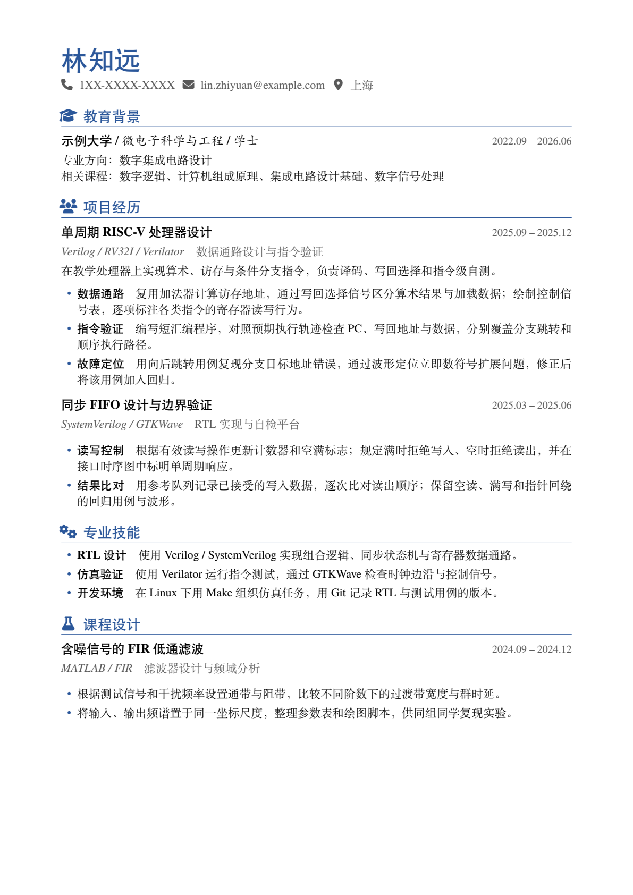

# 中文技术简历模板 · 数字 IC 与 RTL 验证

为电子信息类应届生设计的单页 A4 简历。示例用 RISC-V 处理器和同步 FIFO 两个项目展示个人分工、设计决策与验证结果。



[下载示例 PDF](examples/resume.pdf) · 姓名、院校、项目经历及验证结果均为虚构的填写示例。

## 快速开始

1. 编辑 `resume-zh_CN.tex` 中的姓名和联系方式。GitHub 只填用户名，手机号、邮箱、地点和 GitHub 均可留空。
2. 编辑 `texs/sections.tex`，替换教育背景、项目、技能和课程设计。每个项目保留两三条能说明本人分工和结果的经历。
3. **Overleaf** 用户上传源码 ZIP，主文件选 `resume-zh_CN.tex`，编译器选 **XeLaTeX**。**本地** Linux / macOS 用户运行 `make`，Windows 用户复制下方 PowerShell 命令。默认样例输出一页，个人简历可自然分页。

## 编译

使用 XeLaTeX。已在 Windows 上使用 TeX Live 2026 验证。完整 TeX Live 包含所需字体及宏包；精简安装应具备 `fontspec`、`xeCJK`、`fontawesome6`、`graphicx`、`geometry`、`xcolor`、`titlesec`、`enumitem`、`hyperref`、`bookmark`、`accsupp` 以及下表中的字体。命令均在项目根目录执行。

**Linux / macOS** 使用 GNU Make 和 latexmk。运行 `make` 或 `make zh_CN` 生成 `build/resume.pdf`。`make clean` 清理该主文件的编译缓存和 PDF。日志及辅助文件均写入 `build/`。

**Windows** 在 PowerShell 中直接执行 Makefile 使用的同一条命令。latexmk 会创建输出目录，并按需重复运行 XeLaTeX。

```powershell
latexmk -g -xelatex -interaction=nonstopmode -halt-on-error -file-line-error -outdir=build -jobname=resume resume-zh_CN.tex
```

**Overleaf** 将项目源码压缩为 ZIP 并上传，保留目录结构。将 Main document 设为 `resume-zh_CN.tex`，在项目的 Compiler 设置中选择 **XeLaTeX**，并选择包含 `fontawesome6` 的 TeX Live 版本。点击 Recompile，随后可从页面下载 PDF。[Overleaf 编译设置](https://docs.overleaf.com/getting-started/recompiling-your-project/selecting-a-tex-live-version-and-latex-compiler)

## 项目结构

```text
latex-resume-template/
├── resume-zh_CN.tex           主文件、个人信息和外观参数
├── resume.cls                 标题、日期、列表及联系方式的排版
├── texs/
│   ├── header_with_photo.tex  页眉与可选照片
│   └── sections.tex           教育、项目、技能及可选模块
├── stys/fonts.tex             中西文字体及字形映射
├── examples/resume.pdf         可下载的虚构示例简历
├── images/preview.png         默认 PDF 的实际预览
├── build/resume.pdf           本地编译产物，Git 忽略本目录
├── .github/workflows/example.yml  编译并检查默认样例
├── Makefile
├── .gitignore
├── README.md
└── LICENSE
```

## 填写简历

- **个人信息**　在 `resume-zh_CN.tex` 修改 `\resumename`、`\resumeaddress`、`\resumephone`、`\resumeemail` 和 `\githubuser`。GitHub 只填用户名，页眉会生成完整链接。LaTeX 正文中的百分号、下划线及 & 分别写作 `\%`、`\_`、`\&`。
- **证件照**　将照片保存为 `images/photo.jpg` 或 `images/photo.png`，重新编译即可。同名时 JPG 优先。照片在 **22.5 × 30 mm** 的区域内居中等比缩放，完整保留原图；横图或窄图的余处留白。无照片时页眉自动收起照片栏。路径前缀（不含扩展名）、宽高分别由 `\photopath`、`\photowidth`、`\photoheight` 控制。改为 `\showphotofalse` 可隐藏照片。
- **教育背景**　在 `texs/sections.tex` 复制一组 `\datedsubsection{院校 / 专业 / 学历}{起止年月}` 及其下方的 `\normalline{...}`。自由增删方向、绩点和课程行。
- **专业技能**　在 `skilllist` 中按实际能力增删 `\item`。优先列出能在项目中举例说明的技能。
- **项目经历**　复制一个项目，从 `\datedsubsection` 到 `\end{itemize}`。填写项目名和日期，用 `\role{技术关键词}{角色或分工}` 说明自己的职责，再写项目简介、具体工作和可核实的成果。用自己的项目和实际验证结果替换示例。
- **增删模块**　按 `\sectionTitle{模块名}{图标}` 移动或删除整个区块。文件末尾提供技术作品、实习、科研和荣誉的注释骨架。

## 排版与预览

在主文件中编辑 `\definecolor{fgcolor}{HTML}{2B579A}` 可同步调整姓名、模块标题、横线与列表圆点的颜色。主文件中的 secondary 控制联系方式、日期和技术关键词的深灰色。`\geometry{...}` 控制纸张与四边边距。在 `resume.cls` 中，`\LoadClass[11pt]{article}` 控制基础字号，`\titleformat` 控制标题层级，`\titlespacing*` 和 `\setlist` 控制段落之间的标题与列表间距。姓名字号在页眉姓名处通过 `\Huge` 设置。

用 Poppler 可刷新预览或检查复制顺序。中文提取需使用含 Adobe-GB1 字符映射的工具，Linux 发行版通常通过 `poppler-data` 提供该数据。

```sh
pdftoppm -singlefile -r 144 -png build/resume.pdf images/preview
pdftotext -layout -enc UTF-8 build/resume.pdf -
```

仓库的 GitHub Actions 会编译默认示例，检查页数、中文项目名称及邮箱，并提供 PDF 构建产物。若更换公开示例的内容，请同步更新预览图、示例 PDF 和工作流中的样本文字。

## 来源与修改

基于 luooofan 的中文分支 `zh_CN`，上游源自 billryan 的简历模板。本版保留 default 的深蓝色标题与细横线、字号层级、左右页边距和右对齐日期，移除了其他标题样式、原个人资料、演示图片和参考文献。照片与无照片模式共用同一份正文，字体和图标由 TeX 发行版提供。[上游源码快照](https://github.com/luooofan/resume/tree/874173fdf343941169e7f673f4344c075fc85422) · [早期原作](https://github.com/billryan/resume)

## 授权与字体

模板源码沿用上游 MIT 许可证，原始许可文本见 [LICENSE](LICENSE)。仓库使用 TeX 发行版安装的字体；字体文件各自的授权如下。

| 用途 | 字体 | 授权 |
| --- | --- | --- |
| 中文正文、标题、斜体 | Fandol 宋、黑、楷 | GPL，附字体例外。见 [Fandol 说明](https://mirrors.ctan.org/fonts/fandol/README) |
| 西文与数字 | TeX Gyre Termes | [GUST Font License](https://ctan.org/pkg/tex-gyre) |
| 标题与联系方式图标 | Font Awesome 6 Free | 字体为 SIL OFL 1.1，LaTeX 宏包为 LPPL 1.3c。见 [宏包与字体许可](https://ctan.org/pkg/fontawesome6) |

上游默认使用 Adobe 中文字体，另有 Noto 宋体、黑体两组可选配置，图标依赖随仓库分发的 Font Awesome 字体及生成的宏文件。本版以 `stys/fonts.tex` 保留宋体正文、黑体强调、楷体专业与学历的分工，直接调用发行版的图标宏包。自选其他字体时，请按该字体的许可核对 PDF 嵌入与字体文件再分发条件。
